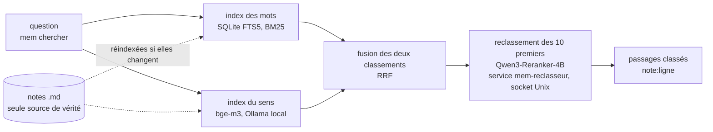
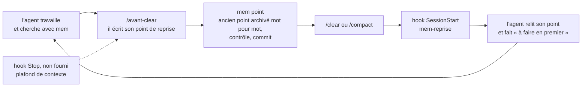

# mem — chercher dans la mémoire de vos agents de code

*English: [README.md](README.md)*

Claude Code (et OpenClaude) gardent une mémoire par projet : des notes Markdown dans
`~/.claude/projects/<projet>/memory/`, avec un index `MEMORY.md` chargé à chaque session.
Quand la mémoire dépasse quelques dizaines de notes, l'agent ne peut plus tout relire :
il cherche avec `grep`, et rate tout ce qui est dit avec d'autres mots.

`mem` est un seul script Python qui cherche dans ces notes **en local** :

- **par mots** : SQLite FTS5 (BM25), accents ignorés, titres et descriptions pesés plus lourd ;
- **par le sens** (facultatif) : vecteurs bge-m3 calculés par un Ollama local ;
- **avec reclassement** (facultatif) : les 10 premiers passages sont renotés par
  Qwen3-Reranker-4B (llama.cpp par node-llama-cpp), sans aucun appel réseau ; quand le système le
  permet, il tourne en plus enfermé sans réseau (`unshare -rn`, voir plus bas).

Les notes restent la seule source : `mem` n'en tient qu'un index, refait dès qu'une note change.
Aucun texte ne quitte la machine.

```
mem chercher "qui a le droit de déployer ?"
mem chercher --vite "migration base"        # sans reclassement : ~0,3 s
mem voir project/deploiement.md:12
mem ajouter --type feedback "titre" < texte
mem etat                                     # notes, passages, lignes écartées comme secrets
mem bench questions.tsv                      # top 1, top 3, MRR sur vos propres questions
mem point point.md                           # point de reprise neuf avant /clear ou /compact
mem selftest
```

## Pourquoi cet outil

`mem` est né d'un problème de coût, pas seulement de recherche. Dans Claude Code, **chaque échange
relit tout le contexte** : les fichiers chargés au démarrage (CLAUDE.md, MEMORY.md) et toute la
conversation. Plus le contexte est gros, plus chaque tour coûte cher, en argent ou en quota.

Le contexte, c'est tout ce que le modèle relit avant de répondre, à chaque tour :

1. **Claude Code lui-même** : ses instructions et la description de ses outils, environ 40 000 tokens
   chez nous (selon la version et les outils activés), présents dès le premier tour ;
2. **les fichiers de démarrage** : CLAUDE.md (global et du projet) et MEMORY.md ;
3. **la conversation** : vos messages, les réponses, les fichiers lus, les sorties de commandes. Elle
   grossit à chaque tour, et c'est elle qui finit par peser le plus.

Le cache des prompts rend cette relecture moins chère, pas gratuite : un tour coûte d'autant plus que
le contexte est gros.

Sur notre projet (plusieurs agents, des semaines de travail), trois choses avaient grossi :

- **CLAUDE.md** : 23 Ko de règles, relus à chaque démarrage et après chaque compact ;
- **MEMORY.md** : 111 lignes, 24 Ko, chargées de même dans chaque session ;
- **les conversations** : la fenêtre de 1 million de tokens permettait de pousser une session
  jusqu'à 500 000 tokens avant de la compacter, et chaque tour relisait alors un demi-million de tokens.

Ce que nous avons fait :

1. **Un plafond de contexte à 250 000 tokens** au lieu de la moitié de la fenêtre de 1 million
   (500 000) : au-delà, l'agent écrit son point de reprise et la session est vidée (/clear) ou
   compactée. Chaque tour coûte alors au plus moitié moins qu'avant. Ce plafond est tenu chez nous
   par un hook `Stop` qui n'est pas fourni ici (voir la fin de la section suivante).
   250 000 est le meilleur compromis **pour notre usage** : assez de place pour une tâche longue
   (lecture de code, tests, relectures) sans vider la session au milieu, assez peu pour que chaque
   tour reste raisonnable. Ce n'est pas une valeur universelle : avec des tâches courtes, un seuil
   plus bas économise davantage ; avec de très gros fichiers à garder sous les yeux, il en faut
   plus. À adapter à votre besoin, en regardant ce que coûtent vos sessions.
2. **Des fichiers chargés au démarrage réduits à l'essentiel** : CLAUDE.md passé de 23 Ko à 4 Ko
   (l'ancienne version complète archivée), MEMORY.md de 111 à 43 lignes (24 Ko à 8 Ko), les
   anciennes entrées déplacées mot pour mot dans `archive/`, sans rien perdre (contrôlé par
   `mem verifier-perte`). Ces deux fichiers pèsent 74 % de moins (47 Ko → 12 Ko, de l'ordre de
   15 000 → 4 000 tokens). Claude Code compris, le démarrage passe d'environ 55 000 à 44 000 tokens,
   et ces ~11 000 tokens sont rendus à la conversation : sous le même plafond, l'agent garde plus de
   messages, de code lu et de résultats en vue avant de devoir passer par /clear.
3. **`mem` pour retrouver le reste à la demande** : ce qui n'est plus chargé d'office reste
   dans les notes, et l'agent le cherche quand il en a besoin, au lieu de tout garder en contexte.
   Une recherche coûte quelques secondes et quelques centaines de tokens de résultats ; garder
   ces notes en contexte coûtait leur taille entière à chaque tour.


Les seuils sont exacts : compactage vers 500 000 tokens avant, plafond de 250 000 après. Les chiffres
du démarrage sont des ordres de grandeur, mesurés au premier tour de nos sessions (champ `usage` des
transcriptions de Claude Code) : 46 000 à 60 000 tokens sur 3 sessions d'avant, 37 000 à 45 000 sur
11 sessions d'après. La part de CLAUDE.md et MEMORY.md est estimée d'après leur taille, le reste revient
à Claude Code, dont la part varie avec sa version et les outils activés (nous avions aussi coupé des
connecteurs inutilisés). Au pire, un tour relisait ~500 000 tokens ; il en relit au plus ~250 000.

Le point de reprise (`mem point`) est ce qui rend le /clear sûr : l'agent repart d'un contexte
vide, mais avec un état écrit par lui-même, et `mem` pour le reste.

## Comment ça marche



- Les notes ne sont jamais modifiées par une recherche : `mem` tient à côté un index
  (`~/.local/share/mem/<projet>.db`), refait pour les seules notes qui ont changé.
- Le sens et le reclassement sont facultatifs : sans Ollama, la recherche s'arrête aux mots ;
  `--vite` s'arrête après la fusion (~0,3 s au lieu de ~7 s).
- Tout reste sur la machine : Ollama en local, et le reclasseur ne fait aucun appel réseau.

## Installation

1. **Le script** (Python 3.11 ou plus, testé avec 3.11 et 3.12 ; numpy pour la recherche par le sens) :
   ```
   install -m 755 mem ~/.local/bin/mem
   mem selftest
   ```
   Lancé depuis un dossier de projet (ou un de ses sous-dossiers, worktrees compris), `mem` trouve
   la mémoire Claude Code de ce projet. Ailleurs : `--dossier` ou `MEM_DIR`. Il n'ouvre jamais par
   défaut la mémoire d'un autre projet.

2. **La recherche par le sens** (facultatif) : [Ollama](https://ollama.com) en local, puis
   `ollama pull bge-m3`. Sans Ollama, `mem` cherche par mots seulement, sans erreur.

3. **Le reclassement** (facultatif) : Node.js 20 ou plus, puis
   ```
   cd reclasseur && ./installer.sh --service
   ```
   Le script installe node-llama-cpp 3.20.0 (version exacte), télécharge le modèle depuis Hugging Face
   (2,5 Go), vérifie son empreinte SHA-256 et, avec `--service`, active une unité systemd utilisateur
   qui garde le modèle chargé. Sans le service, `mem` charge le modèle à chaque recherche (plus lent).

## Intégration à Claude Code : la mémoire, /compact et /clear

Un outil de recherche ne sert que si l'agent pense à s'en servir, et la mémoire n'est utile que si
elle survit à la fin de la conversation. Claude Code offre deux façons de la vider :

- **/compact** remplace la conversation par un résumé écrit par le modèle. La session continue, mais
  le résumé perd des détails (identifiants de commits, chemins, raisons d'une décision).
- **/clear** repart d'une conversation vide. Il ne reste que les fichiers : CLAUDE.md, MEMORY.md et
  les notes. C'est plus économique (chaque échange relit tout le contexte) et plus net, à condition
  que l'agent ait écrit ce qu'il doit savoir avant.

Le cycle proposé, avec les fichiers du dossier `integration/` :

1. **Dire à l'agent quand chercher** : ajouter `integration/CLAUDE.md.extrait` à votre CLAUDE.md
   (global `~/.claude/CLAUDE.md` ou celui du projet).
2. **Avant un /clear ou un /compact** : copier `integration/avant-clear.md` dans `~/.claude/commands/`,
   puis taper `/avant-clear`. L'agent écrit un point de reprise (état vérifié, travaux en cours,
   décisions, prochaine étape, « À FAIRE EN PREMIER ») et le range avec `mem point` :
   l'ancien point part **mot pour mot** dans `archive/point-de-reprise.md`, un contrôle vérifie
   qu'aucune ligne n'a disparu (sinon rien n'est écrit), et le dossier mémoire est commité s'il est
   un dépôt git.
3. **Taper /clear** (ou /compact).
4. **Au redémarrage, le hook relance l'agent** : installer `integration/mem-reprise` dans le PATH
   (`install -m 755 integration/mem-reprise ~/.local/bin/`) et ajouter le contenu de
   `integration/settings.json.extrait` à `~/.claude/settings.json`. À chaque session qui démarre
   après un /clear ou un /compact, son texte est ajouté au contexte : l'agent relit son point,
   fait sa section « À FAIRE EN PREMIER », et cherche avec `mem` avant d'affirmer un état passé.



`mem` reconnaît ces points (« POINT DE REPRISE ») : les plus anciens passent derrière les règles
durables, sauf si la question demande le « dernier » état. Plusieurs agents sur un même projet :
`mem point --note project/point-<agent>.md --archive archive/point-<agent>.md --auteur <agent>`,
ou `MEM_POINT_NOTE` et `MEM_POINT_ARCHIVE` dans l'environnement de chaque agent (le hook lit aussi
`MEM_POINT_NOTE`).

Pour aller plus loin (non fourni) : un hook `Stop` peut surveiller la taille du contexte et demander
`/avant-clear` à l'agent au-delà d'un seuil, avant qu'une session devienne chère.

## Ce que ça coûte, ce que ça rapporte

Mesuré sur un portable (Ryzen 7 8845HS, Radeon 780M intégrée, llama.cpp par Vulkan), sur une mémoire
réelle de 182 notes :

| Mode | Durée d'une recherche |
|---|---|
| `--vite` (mots + sens) | ~0,3 s |
| avec reclassement, service actif | ~6 à 8 s |
| avec reclassement, sans service | ~9 s |
| avec reclassement, processeur seul | ~38 s : utilisez `--vite` ou `MEM_RECLASSER=0` |

Qualité, sur un banc **privé** de 200 questions écrites par un autre agent à partir de cette mémoire
(paraphrases, situations, états passés). MRR : moyenne de 1/rang de la bonne note (1 = toujours en tête).

| | banc de 200 | banc de 50, servi aussi au choix du reclasseur |
|---|---|---|
| mots + sens | MRR 0,64 (114/200 en tête) | MRR 0,68 (31/50 en tête) |
| mots + sens + reclassement | MRR 0,74 (139/200 en tête) | MRR 0,75 (35/50 en tête) |

Limites de ces chiffres : un seul corpus, en français, d'un seul projet ; le choix du reclasseur a été
fait sur ce banc et sur un second de 50 questions. Mesurez sur vos propres questions avec `mem bench`
(format dans `exemples/questions.tsv`) avant de vous fier au reclassement.

## Secrets

Une ligne qui ressemble à un secret (clé privée, jeton connu, `password: …`, URL à identifiants,
longue suite aléatoire…) n'entre pas dans l'index : sa valeur devient `[masqué]`, ou la ligne est
retirée, et `mem etat` la compte. C'est un **filet**, pas une garantie : un mot de passe écrit en
minuscules dans une phrase (« le mot de passe est hunter ») ne se distingue pas de « le mot de passe
est requis » et reste visible. La seule règle sûre : ne pas écrire de secret dans la mémoire.

## Réglages

| Variable | Rôle |
|---|---|
| `MEM_DIR` | dossier mémoire |
| `MEM_DB` | base de l'index (sinon `~/.local/share/mem/<projet>.db`, 0600) |
| `MEM_SENS=0` | sans recherche par le sens |
| `MEM_SENS_URL` | adresse d'Ollama (`http://127.0.0.1:11434/api/embed`) |
| `MEM_SENS_GARDER=0` | laisser Ollama décharger bge-m3 au bout de 5 minutes |
| `MEM_RECLASSER=0` | sans reclassement (comme `--vite`) |
| `MEM_RECLASSEUR` | dossier du reclasseur |
| `MEM_SYNONYMES` | groupes de synonymes en plus (sinon `$XDG_CONFIG_HOME/mem/synonymes.txt`, ou `~/.config/…`) |
| `MEM_RECLASSEUR_SOCKET` | socket du service de reclassement (sinon `$XDG_RUNTIME_DIR/mem-reclasseur.sock` ; jamais `/tmp`) |
| `MEM_PROJETS` | racines des mémoires par projet, séparées par « : » (sinon `~/.claude/projects` puis `~/.openclaude/projects`) |
| `MEM_POINT_NOTE`, `MEM_POINT_ARCHIVE` | note du point de reprise et son archive (`project/point-de-reprise.md`, `archive/point-de-reprise.md`) |
| `AGENT_NOM` | nom de l'agent : `mem ajouter` le note comme auteur, et `mem chercher` ne montre que ses notes et celles sans auteur (`--tous` pour toutes) |

Synonymes propres à un projet : un groupe par ligne, mots séparés par des virgules.
```
relecteur, relecture, revue-de-code
conteneur, vm, proxmox
```

Une question qui demande le « dernier », l'« actuel » ou le « récent » n'est ni cherchée par le sens ni reclassée :
la date y compte plus que la proximité de sens, et `mem` met alors les passages les plus récents en tête.

Conventions reconnues : l'en-tête YAML des notes Claude Code (`name`, `description`, `metadata.type`),
les dates en tête d'entrée (`- 08/11 …`, `## 2026-11-08`), et les notes de reprise (« POINT DE
REPRISE ») traitées comme un journal : leurs vieux passages passent derrière les règles, sauf si la
question demande le « dernier » état.

Sur certains systèmes (par exemple Ubuntu 24.04), les espaces de noms non privilégiés sont bloqués :
`unshare -rn` échoue, et l'installateur écrit alors l'unité sans lui. Le reclasseur ne fait de toute
façon aucun appel réseau ; `unshare` n'est qu'une seconde barrière.

## Licences

`mem` : MIT (voir [LICENSE](LICENSE)). Modèles, téléchargés à l'installation et jamais fournis ici :
bge-m3 (MIT, BAAI), Qwen3-Reranker-4B (Apache 2.0, Qwen) dans sa conversion GGUF de
[giladgd](https://huggingface.co/giladgd/Qwen3-Reranker-4B-GGUF).
