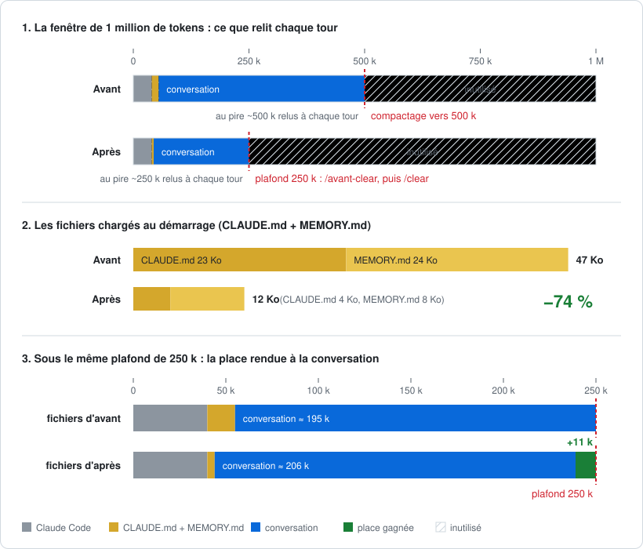
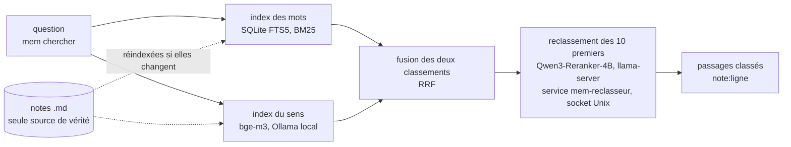
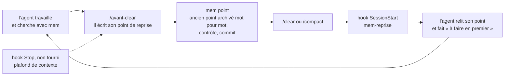

# mem — chercher dans la mémoire de vos agents de code

*English: [README.md](README.md)*

Claude Code, comme OpenClaude, garde une mémoire pour chaque projet. Ce sont des notes Markdown
rangées dans `~/.claude/projects/<projet>/memory/`, avec un index, `MEMORY.md`, que l'agent relit
à chaque session. Tant que les notes sont peu nombreuses, tout va bien. Passé quelques dizaines,
l'agent ne peut plus tout relire : il se rabat sur `grep`, et passe à côté de tout ce qui a été
écrit avec d'autres mots.

`mem` est un seul script Python qui cherche dans ces notes **en local** :

- **par mots** : SQLite FTS5 (BM25), accents ignorés, titres et descriptions pesés plus lourd ;
- **par le sens** (facultatif) : vecteurs bge-m3 calculés par un Ollama local ;
- **avec reclassement** (facultatif) : les 10 premiers passages sont renotés par
  Qwen3-Reranker-4B, que `llama-server` (llama.cpp) garde chargé et qui note les 10 passages ensemble,
  sans aucun appel réseau ; quand le système le permet, il tourne en plus enfermé sans réseau
  (`unshare -rn`, voir plus bas).

Les notes restent la seule source : `mem` n'en tient qu'un index, refait dès qu'une note change.
Aucun texte ne quitte la machine.

## D'où vient `mem`

Je travaille tous les jours avec un **système multi-agents** : plusieurs sessions Claude Code,
chacune avec son rôle (coordination, développement, relecture, exploitation), qui s'échangent des
messages, se passent le travail et partagent la même mémoire de projet. `mem` est né de cette
expérience. La mémoire commune qui grossit, le contexte relu à chaque échange, les décisions
oubliées après un /clear : je les ai rencontrés avant de chercher à les régler, et les chiffres de
ce README ont été mesurés sur cette installation.

Le code et la documentation ont été écrits avec ces agents. Je décide de ce qu'il faut faire, je
valide les changements et je fais refaire les mesures ; les agents écrivent le code et les textes,
se relisent entre eux et lancent les tests.

## Ce que fait `mem`

**`mem` s'arrête à la recherche.** Une chaîne RAG va chercher des passages, les colle d'elle-même dans
l'invite du modèle, et lui fait rédiger une réponse à partir d'eux. `mem` ne fait que la première
étape : c'est une commande de recherche que l'agent lance quand il en a besoin, comme `grep`. Elle
rend des passages classés, avec leur emplacement (`note:ligne`) ; aucun modèle ne rédige de réponse,
et rien n'est ajouté à l'invite dans le dos de l'agent. L'agent lit les passages, ouvre la note au
besoin, et la cite. Le reclassement ne fait que réordonner les résultats, il ne génère aucun texte.
Les hooks fournis, tous facultatifs (plus bas), n'ajoutent que de courts avis au contexte : les noms des notes
voisines après l'écriture d'une note, et, après un /clear, le rappel de relire le point de reprise.

**Notes et conversations.** `mem` donne à un agent une mémoire durable et
vérifiable : règles, décisions, état d'un chantier, point de reprise avant /clear. Ce qui compte est
écrit dans une note qu'une personne peut relire, corriger et committer, et chaque réponse renvoie à
`note:ligne`. Pour une chose seulement dite dans une ancienne conversation, jamais écrite (la
raison d'une décision, les mots exacts de l'utilisateur), `mem retrouver` cherche à part dans les
transcriptions de Claude Code (voir plus bas) : les notes restent la mémoire de travail, les
transcriptions un historique qu'on consulte.

Chaque commande et chaque option a aussi un nom anglais, qui marche de la même façon : `search`, `show`,
`add`, `status`, `duplicates`, `neighbors`, `stale`, `handover`, `check-loss`, `index`, `recall` ; `--dir`, `--fast`,
`--in`, `--all`, `--since`, `--anyway`, `--threshold`, `--repo`, `--author`. L'aide et les messages suivent la
langue du système (français si `LANG` commence par `fr`, anglais sinon) ; `MEM_LANG=fr` ou `MEM_LANG=en` l'impose.

```
mem chercher "qui a le droit de déployer ?"
mem chercher --vite "migration base"        # sans reclassement : ~0,3 s
mem chercher --dans project/ "relais"       # seulement ce sous-dossier (ou une note : project/x.md)
mem voir project/deploiement.md:12
mem ajouter --type feedback "titre" < texte
mem etat                                     # notes, passages, lignes écartées comme secrets
mem doublons                                 # notes qui se répètent ou se contredisent (par le sens)
mem voisins project/x.md                     # notes qui disent déjà ce que dit x.md (hook : integration/mem-voisins-hook.py)
mem perimes                                  # renvois morts : chemin, fichier, commit, note de l'index
mem bench questions.tsv                      # top 1, top 3, MRR sur vos propres questions
mem retrouver "pourquoi l'ancien relais ?"   # échanges passés (transcriptions de Claude Code), voir plus bas
mem retrouver --voir 1a2b3c4d:120            # ce message et ses voisins
mem code "où est géré l'envoi programmé"     # dans le code du dépôt courant, voir plus bas
mem point point.md                           # point de reprise neuf avant /clear ou /compact
mem selftest
```

## Pourquoi cet outil

`mem` est né d'un problème de coût autant que de recherche. Dans Claude Code, **chaque échange
relit tout le contexte** : les fichiers chargés au démarrage (CLAUDE.md, MEMORY.md) et toute la
conversation. Plus le contexte est gros, plus chaque tour coûte cher, en argent ou en quota.

Le contexte, c'est tout ce que le modèle relit avant de répondre, à chaque tour :

1. **Claude Code lui-même** : ses instructions et la description de ses outils, environ 40 000 tokens
   chez nous (selon la version et les outils activés), présents dès le premier tour ;
2. **les fichiers de démarrage** : CLAUDE.md (global et du projet) et MEMORY.md ;
3. **la conversation** : vos messages, les réponses, les fichiers lus, les sorties de commandes. Elle
   grossit à chaque tour, et c'est elle qui finit par peser le plus.

Grâce au cache des prompts, cette relecture coûte moins cher, mais elle se paie quand même, et
d'autant plus que le contexte est gros.

Chez nous, après des semaines de travail à plusieurs agents, trois choses avaient pris trop de place :

- **CLAUDE.md** : 23 Ko de règles, relus à chaque démarrage et après chaque compact ;
- **MEMORY.md** : 111 lignes, 24 Ko, chargées de même dans chaque session ;
- **les conversations** : la fenêtre de 1 million de tokens permettait de pousser une session
  jusqu'à 500 000 tokens avant de la compacter, et chaque tour relisait alors un demi-million de tokens.

Ce que nous avons fait :

1. **Un plafond de contexte à 250 000 tokens** au lieu de la moitié de la fenêtre de 1 million
   (500 000) : au-delà, l'agent écrit son point de reprise et la session est vidée (/clear) ou
   compactée. Chaque tour coûte alors au plus moitié moins qu'avant. Ce plafond est tenu chez nous
   par un hook `Stop` qui n'est pas fourni ici (voir la fin de la section suivante).
   250 000 est le meilleur compromis **pour notre usage** : assez de place pour une tâche longue
   (lecture de code, tests, relectures) sans vider la session au milieu, assez peu pour que chaque
   tour reste raisonnable. Ce seuil dépend du travail : avec des tâches courtes, un seuil
   plus bas économise davantage ; avec de très gros fichiers à garder sous les yeux, il en faut
   plus. À adapter à votre besoin, en regardant ce que coûtent vos sessions.
2. **Des fichiers chargés au démarrage réduits à l'essentiel** : CLAUDE.md passé de 23 Ko à 4 Ko
   (l'ancienne version complète archivée), MEMORY.md de 111 à 43 lignes (24 Ko à 8 Ko), les
   anciennes entrées déplacées mot pour mot dans `archive/`, sans rien perdre (contrôlé par
   `mem verifier-perte`). Ces deux fichiers pèsent 74 % de moins (47 Ko → 12 Ko, de l'ordre de
   15 000 → 4 000 tokens). Claude Code compris, le démarrage passe d'environ 55 000 à 44 000 tokens,
   et ces ~11 000 tokens sont rendus à la conversation : sous le même plafond, l'agent garde plus de
   messages, de code lu et de résultats en vue avant de devoir passer par /clear.
   Pour faire de même sur votre projet : `/alleger-demarrage` (voir la section sur l'intégration plus bas).
3. **`mem` pour retrouver le reste à la demande** : ce qui n'est plus chargé d'office reste
   dans les notes, et l'agent le cherche quand il en a besoin, au lieu de tout garder en contexte.
   Une recherche coûte quelques secondes et quelques centaines de tokens de résultats ; garder
   ces notes en contexte coûtait leur taille entière à chaque tour.

**D'où viennent les économies.** L'essentiel des gains de tokens annoncés vient des deux premières
mesures : alléger CLAUDE.md et MEMORY.md, et plafonner le contexte à 250 k tokens. Ce sont de bonnes
pratiques que vous pouvez appliquer sans installer `mem`. L'outil sert surtout à ne pas perdre
l'accès à ce qu'on sort du démarrage.



Les seuils sont exacts : compactage vers 500 000 tokens avant, plafond de 250 000 après. Les chiffres
du démarrage sont des ordres de grandeur, mesurés au premier tour de nos sessions (champ `usage` des
transcriptions de Claude Code) : 46 000 à 60 000 tokens sur 3 sessions d'avant, 37 000 à 45 000 sur
11 sessions d'après. La part de CLAUDE.md et MEMORY.md est estimée d'après leur taille, le reste revient
à Claude Code, dont la part varie avec sa version et les outils activés (nous avions aussi coupé des
connecteurs inutilisés). Au pire, un tour relisait ~500 000 tokens ; il en relit au plus ~250 000.

Sans point de reprise, un /clear ferait tout oublier à l'agent. Avec `mem point`, il note où il en
est juste avant ; une fois la conversation vidée, il relit cette note et va chercher le reste avec
`mem`.

## Comment ça marche



- Les notes ne sont jamais modifiées par une recherche : `mem` tient à côté un index
  (`~/.local/share/mem/<projet>.db`), refait pour les seules notes qui ont changé.
- Le sens et le reclassement sont facultatifs : sans Ollama, la recherche s'arrête aux mots ;
  `--vite` s'arrête après la fusion (~0,3 s au lieu de ~3 à 4 s).
- Tout reste sur la machine : Ollama en local, et le reclasseur ne fait aucun appel réseau.

## Installation

1. **Le script** (Python 3.11 ou plus, testé avec 3.11 et 3.12 ; numpy pour la recherche par le sens) :
   ```
   install -m 755 mem ~/.local/bin/mem
   mem selftest
   ```
   Lancé depuis un dossier de projet (ou un de ses sous-dossiers, worktrees compris), `mem` trouve
   la mémoire Claude Code de ce projet. Ailleurs : `--dossier` ou `MEM_DIR`. Il n'ouvre jamais par
   défaut la mémoire d'un autre projet.

2. **La recherche par le sens** (facultatif) : [Ollama](https://ollama.com) en local, puis
   `ollama pull bge-m3`. Sans Ollama, `mem` cherche par mots seulement, sans erreur.

3. **Le reclassement** (facultatif) :
   ```
   cd reclasseur && ./installer.sh --service
   ```
   Le script télécharge `llama-server` (llama.cpp b12128, archive officielle pour Linux x86_64 avec
   Vulkan) et le modèle Qwen3-Reranker-4B Q4_0 depuis Hugging Face (2,4 Go), vérifie leurs empreintes
   SHA-256, fait un essai, puis, avec `--service`, active une unité systemd utilisateur qui garde le
   modèle chargé et répond sur un socket Unix réservé à l'utilisateur. Sans carte graphique : `--cpu`.
   Avec une autre version de llama.cpp (CUDA, ROCm, ARM…) : `--llama-server CHEMIN`. L'installateur est écrit pour Linux.
   Service arrêté, `mem` classe par mots et sens, et le signale.

   Sur certains systèmes (par exemple Ubuntu 24.04), les espaces de noms non privilégiés sont bloqués :
   `unshare -rn` échoue, et l'installateur écrit alors l'unité sans lui. Le reclasseur ne fait de toute
   façon aucun appel réseau ; `unshare` n'est qu'une seconde barrière.

   L'ancienne méthode, par Node.js et node-llama-cpp (`installer-node.sh`), marche encore, environ deux
   fois plus lente : le modèle y note les passages un par un.

## Intégration à Claude Code : la mémoire, /compact et /clear

Un outil de recherche ne sert que si l'agent pense à s'en servir, et la mémoire n'est utile que si
elle survit à la fin de la conversation. Claude Code offre deux façons de la vider :

- **/compact** remplace la conversation par un résumé écrit par le modèle. La session continue, mais
  le résumé perd des détails (identifiants de commits, chemins, raisons d'une décision).
- **/clear** repart d'une conversation vide. Il ne reste que les fichiers : CLAUDE.md, MEMORY.md et
  les notes. C'est plus économique (chaque échange relit tout le contexte, qui repart presque vide) et plus net, à condition
  que l'agent ait écrit ce qu'il doit savoir avant.

Le cycle proposé, avec les fichiers du dossier `integration/` :

1. **Dire à l'agent quand chercher** : ajouter `integration/CLAUDE.md.extrait` à votre CLAUDE.md
   (global `~/.claude/CLAUDE.md` ou celui du projet).
2. **Avant un /clear ou un /compact** : copier `integration/avant-clear.md` dans `~/.claude/commands/`,
   puis taper `/avant-clear`. L'agent écrit un point de reprise (état vérifié, travaux en cours,
   décisions, prochaine étape, « À FAIRE EN PREMIER ») et le range avec `mem point` :
   l'ancien point part **mot pour mot** dans `archive/point-de-reprise.md`, un contrôle vérifie
   qu'aucune ligne n'a disparu (sinon rien n'est écrit), et le dossier mémoire est commité s'il est
   un dépôt git.
3. **Taper /clear** (ou /compact).
4. **Au redémarrage, le hook relance l'agent** : installer `integration/mem-reprise` dans le PATH
   (`install -m 755 integration/mem-reprise ~/.local/bin/`) et ajouter le contenu de
   `integration/settings.json.extrait` à `~/.claude/settings.json`. À chaque session qui démarre
   après un /clear ou un /compact, son texte est ajouté au contexte : l'agent relit son point,
   fait sa section « À FAIRE EN PREMIER », et cherche avec `mem` avant d'affirmer un état passé.

**Alléger CLAUDE.md et MEMORY.md (une fois, puis de temps en temps).** Ces deux fichiers sont relus à
chaque échange ; tout le reste peut attendre dans des notes que `mem` retrouve à la demande. Copier
`integration/alleger-demarrage.md` dans `~/.claude/commands/`, puis taper `/alleger-demarrage` : l'agent
archive chaque CLAUDE.md mot pour mot, n'y garde que ce qui doit jouer à chaque échange (interdits et
règles de sécurité, réflexes qui déclenchent une recherche, environnement indispensable), déplace
l'historique, les incidents, les exemples et les procédures longues dans des notes, refait de MEMORY.md
un index (une ligne par règle durable, aucun état de chantier), vérifie avec `mem verifier-perte`
qu'aucune ligne n'est perdue, puis essaie trois recherches. Sans la commande, il suffit de demander à
votre agent : *« Allège CLAUDE.md et MEMORY.md en suivant integration/alleger-demarrage.md de mem :
archive d'abord, déplace sans réécrire, rien de perdu (mem verifier-perte), et montre-moi ce que tu as
gardé. »* Relisez son compte rendu avant de vous y fier.



`mem` reconnaît ces points (« POINT DE REPRISE ») : les plus anciens passent derrière les règles
durables, sauf si la question demande le « dernier » état. Plusieurs agents sur un même projet :
`mem point --note project/point-<agent>.md --archive archive/point-<agent>.md --auteur <agent>`,
ou `MEM_POINT_NOTE` et `MEM_POINT_ARCHIVE` dans l'environnement de chaque agent (le hook lit aussi
`MEM_POINT_NOTE`).

Nous ne le fournissons pas, mais un hook `Stop` peut aussi surveiller la taille du contexte. Passé un
seuil, il demande à l'agent de lancer `/avant-clear`, avant que la session ne coûte trop cher.

## Ce que ça coûte, ce que ça rapporte

Nous avons fait les mesures sur un portable (Ryzen 7 8845HS, Radeon 780M intégrée, llama.cpp par
Vulkan), avec une vraie mémoire de 183 notes.

| Mode | Durée d'une recherche |
|---|---|
| `--vite` (mots + sens) | ~0,3 s |
| avec reclassement, service actif | ~3 à 4 s |
| avec reclassement, processeur seul (`--cpu`) | ~17 à 22 s : utilisez `--vite` ou `MEM_RECLASSER=0` |
| ancienne méthode Node.js, service actif | ~6 à 8 s |

Qualité, sur un banc **privé** de 200 questions écrites par un autre agent à partir de cette mémoire
(paraphrases, situations, états passés). MRR : moyenne de 1/rang de la bonne note (1 = toujours en tête).

| | banc de 200 | banc de 50, servi aussi au choix du reclasseur |
|---|---|---|
| mots + sens | MRR 0,64 (114/200 en tête) | MRR 0,71 (32/50 en tête) |
| mots + sens + reclassement | MRR 0,73 (135/200 en tête) | MRR 0,76 (35/50 en tête) |

Ces chiffres portent sur un seul corpus, en français, d'un seul projet, et le reclasseur a été choisi
sur ce banc et sur un second de 50 questions. Avant de vous fier au reclassement, essayez-le sur vos
propres questions avec `mem bench` (format dans `exemples/questions.tsv`).

## Retrouver un échange passé : `mem retrouver`

```
mem retrouver "pourquoi la sauvegarde ne part pas du serveur"
mem retrouver --qui alice --depuis 2026-10-01 "VM 112"      # seulement les messages d'alice (votre nom d'utilisateur)
mem retrouver --voir 1a2b3c4d:120                        # le message et ses voisins
mem retrouver --indexer                                     # tout indexer d'un coup (le sens est long la 1re fois)
mem retrouver --etat
```

Il lit les transcriptions de Claude Code (`~/.claude/projects/<projet>/<session>.jsonl`) et n'en
garde que les échanges : les messages de l'utilisateur (tapés ou collés), ceux des autres sessions
(messages entre agents) et le texte des réponses. Les sorties d'outils, les rappels système, les
résumés de compaction, les contenus de skills et les sous-agents restent dehors. Chaque ligne passe
par le même filtre de secrets que les notes. Les fichiers sont lus au fil de l'eau (seulement ce qui
s'est ajouté) ; une recherche calcule le sens d'au plus 300 nouveaux passages, `--indexer` (par
exemple toutes les heures dans une minuterie) fait le reste.

Classement : mots (BM25) et sens (bge-m3) fusionnés, avec le même poids que pour les notes. Mesuré
sur trois petits bancs de vraies questions (54 au total, MRR) : ce réglage et un sens 8 fois plus
lourd se valent en moyenne (0,71 et 0,69) ; le sens lourd gagne sur les questions reformulées, perd
sur les mots-clés, et perd sur le seul jeu tenu à l'écart du réglage (0,67 contre 0,78). Le
reclasseur n'y gagnait rien (`--reclasser` pour l'essayer quand même). Ces chiffres viennent d'une
seule installation.

Un résultat est un indice daté, jamais l'état actuel : ce qui a été dit a pu changer depuis.
L'index (`~/.local/share/mem/conversations.db`, 0600) contient vos conversations, secrets masqués
mais tout le reste en clair : ne le donnez jamais à un service ou un agent distant. Seul le format de
Claude Code est lu.

Deux fichiers facultatifs : `~/.config/mem/utilisateur` (le nom affiché pour vos messages, sinon « user ») et
`~/.config/mem/canaux` (préfixes de canal, un par ligne : « [Salon — Alice · 101500] texte » est
alors rangé sous « alice (Salon) »).

## Chercher dans le code : `mem code`

```
mem code "où vérifie-t-on que le certificat HTTPS va expirer"   # dans le dépôt git courant
mem code --vite "verrou de la boîte"                           # sans reclasseur
mem code --depot ~/projets/app --dans app/services "envoi programmé"
mem code --indexer                                              # tout indexer d'un coup
```

La même recherche que pour les notes (mots, sens, reclasseur), sur le code d'un dépôt. Un agent
qui cherche « où est le code qui fait X » sans en connaître les noms enchaîne d'habitude des `grep` au jugé ;
`mem code` lui donne les fichiers et les lignes à lire.

Ce qui est lu : les fichiers suivis par git (`.py`, `.yaml`, `.yml`, `.sh`, `.js`, `.ts`, `.toml`) ;
hors dépôt git, l'arborescence sans dossiers cachés ni dépendances (`node_modules`, `venv`…). Jamais
de lien symbolique ni de fichier de plus de 500 Ko. Le Python est découpé par fonction, classe et
méthode (décorateurs compris), le reste par blocs ; les petits morceaux voisins sont regroupés
jusqu'à 1 500 caractères environ. Le code est indexé tel quel, sans le filtre de secrets des
notes : l'index ne contient rien que le dépôt ne montre déjà (hors dépôt git, un fichier de
secrets qui n'est pas caché serait lu ; donnez alors `--depot` sur le seul dossier du code).
L'index est à part (`~/.local/share/mem/<dépôt>.code.db`, 0600) et se met à jour à la recherche
suivante quand un fichier change. La première fois, le sens est long : environ 6 minutes pour 200
fichiers.

Mesuré sur une application de 200 fichiers (Python et YAML), deux jeux de 40 questions « où
est le code qui… », formulées sans les noms du code ; rang du premier bon fichier (MRR) :

| | jeu 1 | jeu 2 |
|---|---|---|
| `grep` mécanique des mots de la question | 0,34 | 0,26 |
| memtomem 0.7.12 (hybride, bge-m3) | 0,75 | 0,78 |
| memtomem + le reclasseur de mem | 0,91 | 0,93 |
| `mem code --vite` | 0,87 | 0,78 |
| `mem code` | 0,94 | 0,90 |

Temps d'une recherche : 0,3 s avec `--vite`, environ 6 s avec le reclasseur (20 passages renotés au
lieu de 10). Le jeu 2 a été écrit à part, à partir des docstrings d'autres fichiers que le jeu 1 ;
mais le regroupement des petits morceaux a été choisi après l'avoir passé (il faisait 0,85 sans) :
aucun des deux jeux n'est plus tout à fait neutre. Ces chiffres viennent d'un seul dépôt.

## Secrets

Une ligne qui ressemble à un secret (clé privée, jeton connu, `password: …`, URL à identifiants,
longue suite aléatoire…) n'entre pas dans l'index : sa valeur devient `[masqué]`, ou la ligne est
retirée, et `mem etat` la compte. Ce masquage repose sur des formes reconnaissables et **en laisse passer** : un mot de passe écrit en
minuscules dans une phrase (« le mot de passe est hunter ») ne se distingue pas de « le mot de passe
est requis » et reste visible. Le plus sûr reste de ne jamais écrire de secret dans la mémoire.

## Réglages

| Variable | Rôle |
|---|---|
| `MEM_DIR` | dossier mémoire |
| `MEM_LANG` | `fr` ou `en` : langue de l'aide et des messages (défaut : d'après `LC_ALL`, `LC_MESSAGES`, `LANG` ; anglais) |
| `MEM_DB` | base de l'index (sinon `~/.local/share/mem/<projet>.db`, 0600) |
| `MEM_SENS=0` | sans recherche par le sens |
| `MEM_SENS_URL` | adresse d'Ollama (`http://127.0.0.1:11434/api/embed`) |
| `MEM_SENS_GARDER=0` | laisser Ollama décharger bge-m3 au bout de 5 minutes |
| `MEM_RECLASSER=0` | sans reclassement (comme `--vite`) |
| `MEM_RECLASSEUR` | dossier du reclasseur |
| `MEM_SYNONYMES` | groupes de synonymes en plus (sinon `$XDG_CONFIG_HOME/mem/synonymes.txt`, ou `~/.config/…`) |
| `MEM_RECLASSEUR_SOCKET` | socket du service de reclassement (sinon `$XDG_RUNTIME_DIR/mem-reclasseur.sock` ; jamais `/tmp`) |
| `MEM_PROJETS` | racines des mémoires par projet, séparées par « : » (sinon `~/.claude/projects` puis `~/.openclaude/projects`) |
| `MEM_POINT_NOTE`, `MEM_POINT_ARCHIVE` | note du point de reprise et son archive (`project/point-de-reprise.md`, `archive/point-de-reprise.md`) |
| `AGENT_NOM` | nom de l'agent : `mem ajouter` le note comme auteur, et `mem chercher` ne montre que ses notes et celles sans auteur (`--tous` pour toutes) |
| `MEM_RETROUVER_DB` | base de `mem retrouver` (sinon `~/.local/share/mem/conversations.db`) |
| `MEM_RETROUVER_SOURCE` | dossier des transcriptions (sinon `~/.claude/projects`) |
| `MEM_RETROUVER_POIDS_SENS` | poids du sens dans la fusion de `mem retrouver` (0.5) |
| `MEM_UTILISATEUR` | nom affiché pour vos messages (sinon `~/.config/mem/utilisateur`, ou « user ») |
| `MEM_CODE_DB` | base de `mem code` (sinon `~/.local/share/mem/<dépôt>.code.db`) |
| `MEM_CODE_EXT` | extensions lues par `mem code`, séparées par des virgules (`.py,.yaml,.yml,.sh,.js,.ts,.toml`) |
| `MEM_CODE_REGROUPE` | taille visée des passages regroupés de `mem code`, en caractères (1500 ; 0 : jamais regroupés) |

### Synonymes, dates et conventions

Synonymes propres à un projet : un groupe par ligne, mots séparés par des virgules.
```
relecteur, relecture, revue-de-code
conteneur, vm, proxmox
```

Une question qui demande le « dernier », l'« actuel » ou le « récent » n'est ni cherchée par le sens ni reclassée :
la date y compte plus que la proximité de sens, et `mem` met alors les passages les plus récents en tête.

Conventions reconnues : l'en-tête YAML des notes Claude Code (`name`, `description`, `metadata.type`),
les dates en tête d'entrée (`- 08/11 …`, `## 2026-11-08`), et les notes de reprise (« POINT DE
REPRISE ») traitées comme un journal : leurs vieux passages passent derrière les règles, sauf si la
question demande le « dernier » état. Une note posée à la racine de la mémoire sans `type:` est
traitée comme un index et reste hors de la recherche par défaut ; `mem etat` la signale.

## Contenu du dépôt

- `mem` : le script, seul fichier indispensable ;
- `reclasseur/` : l'installateur du reclasseur (llama-server), et l'ancienne méthode par Node.js ;
- `systemd/` : l'unité utilisateur du reclasseur (et celle de l'ancienne méthode) ;
- `integration/` : de quoi brancher `mem` sur Claude Code (extraits de CLAUDE.md et de settings.json,
  hooks, procédure avant /clear, allègement du démarrage) ;
- `exemples/` : une petite mémoire d'exemple et un banc de questions au format de `mem bench` ;
- `docs/` : les schémas du contexte.

## Licences

`mem` : MIT (voir [LICENSE](LICENSE)). Téléchargés à l'installation et jamais fournis ici :
[llama.cpp](https://github.com/ggml-org/llama.cpp) (MIT, ggml-org) ; les modèles bge-m3 (MIT, BAAI), Qwen3-Reranker-4B (Apache 2.0, Qwen) dans sa conversion GGUF de
[giladgd](https://huggingface.co/giladgd/Qwen3-Reranker-4B-GGUF).
