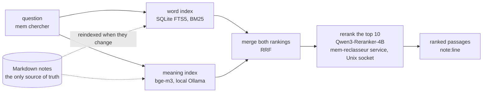

# mem — search your coding agents' memory

*Français : [README.fr.md](README.fr.md)*

Claude Code (and OpenClaude) keep a per-project memory: Markdown notes in
`~/.claude/projects/<project>/memory/`, with a `MEMORY.md` index loaded into every session.
Once the memory grows past a few dozen notes, the agent can no longer reread it all:
it falls back to `grep`, and misses anything phrased with different words.

`mem` is a single Python script that searches those notes **locally**:

- **by words**: SQLite FTS5 (BM25), accent-insensitive, titles and descriptions weighted higher;
- **by meaning** (optional): bge-m3 embeddings computed by a local Ollama;
- **with reranking** (optional): the top 10 passages are rescored by Qwen3-Reranker-4B
  (llama.cpp through node-llama-cpp), with no network calls; where the system allows it, it also runs
  locked out of the network (`unshare -rn`, see below).

The notes stay the only source of truth: `mem` only keeps an index, rebuilt whenever a note changes.
No text leaves the machine.

The tool itself speaks French (commands, help, messages); the commands are short and listed below.

```
mem chercher "who is allowed to deploy?"     # search
mem chercher --vite "database migration"     # no reranking: ~0.3 s
mem chercher --dans project/ "relay"         # only this subfolder (or one note: project/x.md)
mem voir project/deploiement.md:12           # show a passage in context
mem ajouter --type feedback "title" < text   # add a note
mem etat                                     # notes, passages, lines withheld as secrets
mem doublons                                 # notes that repeat or contradict each other (by meaning)
mem perimes                                  # dead references: path, file, commit, index entry
mem bench questions.tsv                      # top 1, top 3, MRR on your own questions
mem point point.md                           # new handover note before /clear or /compact
mem selftest
```

## Why this tool

`mem` came out of a cost problem, not only a search problem. In Claude Code, **every turn rereads the
whole context**: the files loaded at startup (CLAUDE.md, MEMORY.md) and the entire conversation.
The bigger the context, the more each turn costs, in money or in quota.

The context is everything the model rereads before answering, on every turn:

1. **Claude Code itself**: its instructions and tool descriptions, about 40,000 tokens for us
   (depending on the version and enabled tools), there from the first turn;
2. **the startup files**: CLAUDE.md (global and project) and MEMORY.md;
3. **the conversation**: your messages, the answers, the files read, the command outputs. It grows on
   every turn, and ends up weighing the most.

Prompt caching makes this rereading cheaper, not free: the bigger the context, the more a turn costs.

On our project (several agents, weeks of work), three things had grown:

- **CLAUDE.md**: 23 KB of rules, reread at every start and after every compaction;
- **MEMORY.md**: 111 lines, 24 KB, loaded into every session as well;
- **conversations**: the 1-million-token window allowed a session to reach 500,000 tokens before
  being compacted, and every turn then reread half a million tokens.

What we did:

1. **A 250,000-token context ceiling** instead of half the 1-million window (500,000): past it, the
   agent writes its handover note and the session is cleared (/clear) or compacted. Each turn then
   costs at most half what it did. We enforce this ceiling with a `Stop` hook that is not included
   here (see the end of the next section).
   250,000 is the best trade-off **for our use**: enough room for a long task (reading code, running
   tests, reviews) without clearing the session halfway, small enough to keep each turn reasonable.
   It is not a universal value: with short tasks, a lower threshold saves more; with very large files
   to keep in view, you need more. Adapt it to your needs by watching what your sessions cost.
2. **Startup files cut down to the essentials**: CLAUDE.md from 23 KB to 4 KB (the full old version
   archived), MEMORY.md from 111 to 43 lines (24 KB to 8 KB), older entries moved verbatim into
   `archive/`, nothing lost (checked with `mem verifier-perte`). These two files are 74% lighter
   (47 KB → 12 KB, roughly 15,000 → 4,000 tokens). Claude Code included, startup goes from about 55,000
   to 44,000 tokens, and those ~11,000 tokens are given back to the conversation: under the same ceiling,
   the agent keeps more messages, code and results in view before it has to go through /clear.
3. **`mem` to fetch the rest on demand**: what is no longer loaded up front stays in the notes, and
   the agent searches for it when needed instead of keeping everything in context. A search costs a
   few seconds and a few hundred tokens of results; keeping those notes in context cost their full
   size on every turn.


The thresholds are exact: compaction around 500,000 tokens before, a 250,000 ceiling after. The startup
figures are orders of magnitude, measured on the first turn of our sessions (the `usage` field of Claude
Code transcripts): 46,000 to 60,000 tokens over 3 sessions before, 37,000 to 45,000 over 11 sessions
after. The share of CLAUDE.md and MEMORY.md is estimated from their size; the rest is Claude Code's own,
which varies with its version and enabled tools (we had also turned off unused connectors). At worst, a
turn used to reread ~500,000 tokens; it now rereads ~250,000 at most.

The handover note (`mem point`) is what makes /clear safe: the agent restarts from an empty context,
but with a state it wrote itself, and `mem` for everything else.

## How it works



- A search never modifies the notes: `mem` keeps an index next to them
  (`~/.local/share/mem/<project>.db`), rebuilt only for the notes that changed.
- Meaning and reranking are optional: without Ollama, search stops at words;
  `--vite` stops after the merge (~0.3 s instead of ~7 s).
- Everything stays on the machine: Ollama runs locally, and the reranker makes no network calls.

## Install

1. **The script** (Python 3.11 or later, tested with 3.11 and 3.12; numpy for search by meaning):
   ```
   install -m 755 mem ~/.local/bin/mem
   mem selftest
   ```
   Run from a project directory (or any subdirectory, worktrees included), `mem` finds that
   project's Claude Code memory. Elsewhere: `--dossier` or `MEM_DIR`. It never opens another
   project's memory by default.

2. **Search by meaning** (optional): a local [Ollama](https://ollama.com), then `ollama pull bge-m3`.
   Without Ollama, `mem` searches by words only, without error.

3. **Reranking** (optional): Node.js 20 or later, then
   ```
   cd reclasseur && ./installer.sh --service
   ```
   It installs node-llama-cpp 3.20.0 (exact version), downloads the model from Hugging Face (2.5 GB),
   checks its SHA-256 and, with `--service`, enables a systemd user unit that keeps the model loaded.
   Without the service, `mem` loads the model on every search (slower).

## Claude Code integration: memory, /compact and /clear

A search tool only helps if the agent remembers to use it, and memory only helps if it survives the
end of the conversation. Claude Code offers two ways to empty the context:

- **/compact** replaces the conversation with a summary written by the model. The session goes on,
  but the summary loses details (commit ids, paths, the reason behind a decision).
- **/clear** starts from an empty conversation. Only files remain: CLAUDE.md, MEMORY.md and the notes.
  It is cheaper (every turn rereads the whole context) and cleaner, provided the agent wrote down what
  it needs to know beforehand.

The suggested cycle, with the files in `integration/` (written in French; translate them freely):

1. **Tell the agent when to search**: add `integration/CLAUDE.md.extrait` to your CLAUDE.md
   (global `~/.claude/CLAUDE.md` or the project's).
2. **Before /clear or /compact**: copy `integration/avant-clear.md` into `~/.claude/commands/`,
   then type `/avant-clear`. The agent writes a handover note ("POINT DE REPRISE": verified state,
   work in progress, decisions, next step, "do this first") and files it with `mem point`: the
   previous note goes **verbatim** into `archive/point-de-reprise.md`, a check makes sure no line was
   lost (otherwise nothing is written), and the memory directory is committed if it is a git repo.
3. **Type /clear** (or /compact).
4. **On restart, the hook puts the agent back on track**: install `integration/mem-reprise` on your
   PATH (`install -m 755 integration/mem-reprise ~/.local/bin/`) and merge
   `integration/settings.json.extrait` into `~/.claude/settings.json`. Every session that starts after
   a /clear or /compact gets its text in context: the agent rereads its handover note, does its
   "do this first" section, and searches with `mem` before stating any past state.


`mem` recognises these notes ("POINT DE REPRISE"): older ones rank below lasting rules, unless the
question asks for the "latest" state. Several agents on one project:
`mem point --note project/point-<agent>.md --archive archive/point-<agent>.md --auteur <agent>`,
or `MEM_POINT_NOTE` and `MEM_POINT_ARCHIVE` in each agent's environment (the hook reads
`MEM_POINT_NOTE` too).

Going further (not included): a `Stop` hook can watch the context size and ask the agent to run
`/avant-clear` past a threshold, before a session gets expensive.

## Cost and benefit

Measured on a laptop (Ryzen 7 8845HS, integrated Radeon 780M, llama.cpp over Vulkan), on a real
memory of 182 notes:

| Mode | Time per search |
|---|---|
| `--vite` (words + meaning) | ~0.3 s |
| reranking, service running | ~6 to 8 s |
| reranking, no service | ~9 s |
| reranking, CPU only | ~38 s: use `--vite` or `MEM_RECLASSER=0` |

Quality, on a **private** benchmark of 200 questions written by another agent from that memory
(paraphrases, situations, past states). MRR: mean of 1/rank of the right note (1 = always first).

| | 200-question set | 50-question set, also used to choose the reranker |
|---|---|---|
| words + meaning | MRR 0.64 (114/200 ranked first) | MRR 0.68 (31/50 ranked first) |
| words + meaning + reranking | MRR 0.74 (139/200 ranked first) | MRR 0.75 (35/50 ranked first) |

Limits of these figures: a single corpus, in French, from a single project; the reranker was chosen
on these sets. Measure on your own questions with `mem bench` (format in `exemples/questions.tsv`)
before relying on reranking.

## Secrets

A line that looks like a secret (private key, known token format, `password: …`, URL with credentials,
long random string…) does not enter the index: its value becomes `[masqué]`, or the line is dropped,
and `mem etat` counts it. This is a **safety net, not a guarantee**: a lowercase password inside a
sentence ("the password is hunter") cannot be told apart from "the password is required" and stays
visible. The only reliable rule: do not write secrets into agent memory.

## Settings

| Variable | Purpose |
|---|---|
| `MEM_DIR` | memory directory |
| `MEM_DB` | index database (default `~/.local/share/mem/<project>.db`, mode 0600) |
| `MEM_SENS=0` | no search by meaning |
| `MEM_SENS_URL` | Ollama endpoint (`http://127.0.0.1:11434/api/embed`) |
| `MEM_SENS_GARDER=0` | let Ollama unload bge-m3 after 5 minutes |
| `MEM_RECLASSER=0` | no reranking (same as `--vite`) |
| `MEM_RECLASSEUR` | reranker directory |
| `MEM_SYNONYMES` | extra synonym groups (default `$XDG_CONFIG_HOME/mem/synonymes.txt`, or `~/.config/…`) |
| `MEM_RECLASSEUR_SOCKET` | reranking service socket (default `$XDG_RUNTIME_DIR/mem-reclasseur.sock`; never `/tmp`) |
| `MEM_PROJETS` | roots of per-project memories, separated by ":" (default `~/.claude/projects` then `~/.openclaude/projects`) |
| `MEM_POINT_NOTE`, `MEM_POINT_ARCHIVE` | handover note and its archive (`project/point-de-reprise.md`, `archive/point-de-reprise.md`) |
| `AGENT_NOM` | agent name: `mem ajouter` records it as author, and `mem chercher` only shows that agent's notes and notes without an author (`--tous` for all) |

Project-specific synonyms: one group per line, words separated by commas.
```
reviewer, review, code-review
container, vm, proxmox
```

The built-in synonyms, stop words and date formats are French; English notes are searched by words and
by meaning, but benefit less from those helpers.

A question asking for the "latest", "current" or "recent" state (« dernier », « actuel », « récent ») is neither
searched by meaning nor reranked: dates matter more than closeness of meaning there, and `mem` puts the most recent passages first.

Recognised conventions: the YAML front matter of Claude Code notes (`name`, `description`,
`metadata.type`), dates at the start of an entry (`- 08/11 …`, `## 2026-11-08`), and handover notes
("POINT DE REPRISE") treated as a log: their old passages rank below rules, unless the question asks
for the "latest" (« dernier ») state.

On some systems (Ubuntu 24.04 for instance), unprivileged user namespaces are blocked: `unshare -rn`
fails, and the installer then writes the unit without it. The reranker makes no network calls anyway;
`unshare` is only a second barrier.

## Licences

`mem`: MIT (see [LICENSE](LICENSE)). Models, downloaded at install time and never shipped here:
bge-m3 (MIT, BAAI), Qwen3-Reranker-4B (Apache 2.0, Qwen) in its GGUF conversion by
[giladgd](https://huggingface.co/giladgd/Qwen3-Reranker-4B-GGUF).
