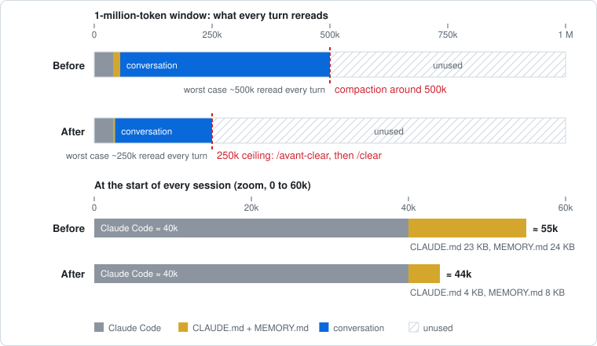
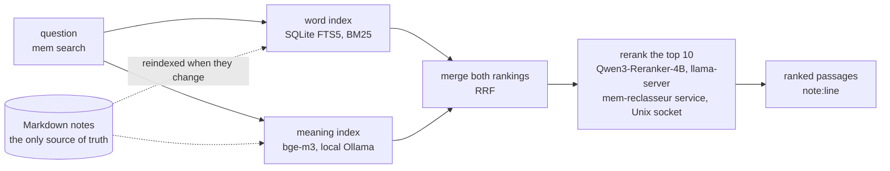
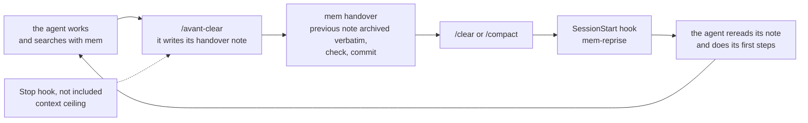

# mem — search your coding agents' memory

*Français : [README.fr.md](README.fr.md)*

Claude Code, like OpenClaude, keeps a memory for each project. It is a set of Markdown notes in
`~/.claude/projects/<project>/memory/`, plus a `MEMORY.md` index the agent rereads at every session.
With a handful of notes, that works fine. Past a few dozen, the agent can no longer reread
everything: it falls back to `grep`, and misses whatever was written in other words.

`mem` is a single Python script that searches those notes **locally**:

- **by words**: SQLite FTS5 (BM25), accent-insensitive, titles and descriptions weighted higher;
- **by meaning** (optional): bge-m3 embeddings computed by a local Ollama;
- **with reranking** (optional): the top 10 passages are rescored by Qwen3-Reranker-4B
  which `llama-server` (llama.cpp) keeps loaded and which scores the 10 passages in one batch, with no
  network calls; where the system allows it, it also runs locked out of the network (`unshare -rn`,
  see below).

The notes stay the only source of truth: `mem` only keeps an index, rebuilt whenever a note changes.
No text leaves the machine.

## Where `mem` comes from

I work every day with a **multi-agent system**: several Claude Code sessions, each with its own
role (coordination, development, review, operations), that message each other, hand work over and
share the same project memory. `mem` grew out of that experience. The shared memory that keeps
growing, the context reread on every turn, the decisions lost after a /clear: I ran into each
of them before trying to fix them, and the figures in this README were measured on that setup.

The code and the documentation were written with these agents. I decide what needs doing, approve
the changes and have the measurements re-run; the agents write the code and the text, review each
other's work and run the tests.

## What `mem` does

**`mem` stops at search.** A RAG pipeline retrieves passages, pastes them into the model's prompt on
its own, and has the model write an answer from them. `mem` only does the first step: it is a command the agent runs when it needs it, just as it would run `grep`. But `grep`
only finds the exact words; `mem` also finds a passage written in other words. It returns passages
ranked from most to least relevant, with their location (`note:line`); no model writes an answer, and nothing is added to the prompt behind the
agent's back. The agent reads the passages, opens the note if needed, and cites it. The reranker
only reorders results, it never generates text. The hooks provided, all optional (below), only add short notices
to the context: the names of similar notes after a note is written, and, after /clear, a reminder to
reread the handover note.

**Notes and conversations.** `mem` gives an agent a durable, checkable memory:
rules, decisions, the state of a piece of work, the handover before /clear. Whatever matters is
written in a note that a person can read, correct and commit, and every answer points back to
`note:line`. For something that was only said in an old conversation and never written down (the
reason for a decision, the user's exact words), `mem recall` searches Claude Code transcripts
separately (see below): notes stay the working memory, transcripts a history you look things up in.

Every command and option has an English name (below) and a French one (`mem chercher`, `--vite`…):
both work. Help and messages follow your locale (French if `LANG` starts with `fr`, English otherwise);
`MEM_LANG=en` or `MEM_LANG=fr` forces one.

```
mem search "who is allowed to deploy?"       # search
mem search --fast "database migration"       # no reranking: ~0.3 s
mem search --in project/ "relay"             # only this subfolder (or one note: project/x.md)
mem search --json "relay" | jq -r .ref      # one JSON line per result, for scripts (also: recall, code)
mem show project/deploiement.md:12           # show a passage in context
mem add --type feedback "title" < text       # add a note
mem status                                   # notes, passages, lines withheld as secrets
mem duplicates                               # notes that repeat or contradict each other (by meaning)
mem neighbors project/x.md                   # notes that already say what x.md says (hook: integration/mem-voisins-hook.py)
mem stale                                    # dead references: path, file, commit, index entry
mem bench questions.tsv                      # top 1, top 3, MRR on your own questions
mem recall "why did we drop the old relay?"  # past conversations (Claude Code transcripts), see below
mem recall --show 1a2b3c4d:120               # that message and its neighbors
mem code "where is scheduled sending handled"  # in the current repository's code, see below
mem handover point.md                        # new handover note before /clear or /compact
mem selftest
```

## Why this tool

`mem` came out of a cost problem as much as a search problem. In Claude Code, **every turn rereads the
whole context**: the files loaded at startup (CLAUDE.md, MEMORY.md) and the entire conversation.
The bigger the context, the more each turn costs, in money or in quota.

The context is everything the model rereads before answering, on every turn:

1. **Claude Code itself**: its instructions and tool descriptions, about 40,000 tokens for us
   (depending on the version and enabled tools), there from the first turn;
2. **the startup files**: CLAUDE.md (global and project) and MEMORY.md;
3. **the conversation**: your messages, the answers, the files read, the command outputs. It grows on
   every turn, and ends up weighing the most.

Prompt caching lowers the price of this rereading, but you still pay for it, and more so as the
context grows.

In our project, after weeks of work with several agents, three things had grown too big:

- **CLAUDE.md**: 23 KB of rules, reread at every start and after every compaction;
- **MEMORY.md**: 111 lines, 24 KB, loaded into every session as well;
- **conversations**: the 1-million-token window allowed a session to reach 500,000 tokens before
  being compacted, and every turn then reread half a million tokens.

What we did:

1. **A 250,000-token context ceiling** instead of half the 1-million window (500,000): past it, the
   agent writes its handover note and the session is cleared (/clear) or compacted. Each turn then
   costs at most half what it did. We enforce this ceiling with a `Stop` hook that is not included
   here (see the end of the next section).
   250,000 is the best trade-off **for our use**: enough room for a long task (reading code, running
   tests, reviews) without clearing the session halfway, small enough to keep each turn reasonable.
   The right threshold depends on the work: with short tasks, a lower threshold saves more; with very large files
   to keep in view, you need more. Adapt it to your needs by watching what your sessions cost.
2. **Startup files cut down to the essentials**: CLAUDE.md from 23 KB to 4 KB (the full old version
   archived), MEMORY.md from 111 to 43 lines (24 KB to 8 KB), older entries moved verbatim into
   `archive/`, nothing lost (checked with `mem check-loss`). These two files are 74% lighter
   (47 KB → 12 KB, roughly 15,000 → 4,000 tokens). Claude Code included, startup goes from about 55,000
   to 44,000 tokens, and those ~11,000 tokens are given back to the conversation: under the same ceiling,
   the agent keeps more messages, code and results in view before it has to go through /clear.
   To do the same on your project: `/alleger-demarrage` (see the integration section below).
3. **`mem` to fetch the rest on demand**: what is no longer loaded up front stays in the notes, and
   the agent searches for it when needed instead of keeping everything in context. A search costs a
   few seconds and a few hundred tokens of results; keeping those notes in context cost their full
   size on every turn.

**Where the savings come from.** Most of the token savings above come from the first two steps:
slimming CLAUDE.md and MEMORY.md, and capping the context at 250k tokens. These are good practices
you can apply without installing `mem`. The tool is mainly there so that what you move out of the
startup files stays within reach.



The thresholds are settings, hence exact: compaction around 500,000 tokens before, a 250,000 ceiling after. The startup
figures are orders of magnitude, measured on the first turn of our sessions (the `usage` field of Claude
Code transcripts): 46,000 to 60,000 tokens over 3 sessions before, 37,000 to 45,000 over 11 sessions
after. The share of CLAUDE.md and MEMORY.md is estimated from their size; the rest is Claude Code's own,
which varies with its version and enabled tools (we had also turned off unused connectors). At worst, a
turn used to reread ~500,000 tokens; it now rereads ~250,000 at most.

Without a handover note, a /clear would make the agent forget everything. With `mem handover`, it
writes down where it stands just before; once the conversation is cleared, it rereads that note and
looks up the rest with `mem`.

## How it works



- A search never modifies the notes: `mem` keeps an index next to them
  (`~/.local/share/mem/<project>.db`), rebuilt only for the notes that changed.
- Meaning and reranking are optional: without Ollama, search stops at words;
  `--fast` stops after the merge (~0.3 s instead of ~3 to 4 s).
- Everything stays on the machine: Ollama runs locally, and the reranker makes no network calls.

## Install

1. **The script** (Python 3.11 or later, tested with 3.11 and 3.12; numpy for search by meaning):
   ```
   install -m 755 mem ~/.local/bin/mem
   mem selftest
   ```
   Run from a project directory (or any subdirectory, worktrees included), `mem` finds that
   project's Claude Code memory. Elsewhere: `--dir` or `MEM_DIR`. It never opens another
   project's memory by default.

2. **Search by meaning** (optional): a local [Ollama](https://ollama.com), then `ollama pull bge-m3`.
   Without Ollama, `mem` searches by words only, without error.

3. **Reranking** (optional):
   ```
   cd reclasseur && ./installer.sh --service
   ```
   The script downloads `llama-server` (llama.cpp b12128, the official Linux x86_64 Vulkan build) and
   the Qwen3-Reranker-4B Q4_0 model from Hugging Face (2.4 GB), checks their SHA-256, runs a test, and,
   with `--service`, enables a systemd user unit that keeps the model loaded and answers on a Unix
   socket only the user can open. No GPU: `--cpu`. With another llama.cpp build (CUDA, ROCm, ARM…):
   `--llama-server PATH`. The installer is written for Linux.
   When the service is stopped, `mem` ranks by words and meaning only, and says so.

   On some systems (Ubuntu 24.04 for instance), unprivileged user namespaces are blocked: `unshare -rn`
   fails, and the installer then writes the unit without it. The reranker makes no network calls anyway;
   `unshare` is only a second barrier.

   The older method, through Node.js and node-llama-cpp (`installer-node.sh`), still works, about twice
   as slow: there the model scores passages one at a time.

## Claude Code integration: memory, /compact and /clear

A search tool only helps if the agent remembers to use it, and memory only helps if it survives the
end of the conversation. Claude Code offers two ways to empty the context:

- **/compact** replaces the conversation with a summary written by the model. The session goes on,
  but the summary loses details (commit ids, paths, the reason behind a decision).
- **/clear** starts from an empty conversation. Only files remain: CLAUDE.md, MEMORY.md and the notes.
  It is cheaper (every turn rereads the whole context, which now starts almost empty), and nothing
  depends on a summary that loses details, provided the agent wrote down what it needs to know
  beforehand.

The suggested cycle, with the files in `integration/` (written in French; translate them freely):

1. **Tell the agent when to search**: add `integration/CLAUDE.md.extrait` to your CLAUDE.md
   (global `~/.claude/CLAUDE.md` or the project's).
2. **Before /clear or /compact**: copy `integration/avant-clear.md` into `~/.claude/commands/`,
   then type `/avant-clear`. The agent writes a handover note ("POINT DE REPRISE": verified state,
   work in progress, decisions, next step, "do this first") and files it with `mem handover`: the
   previous note goes **verbatim** into `archive/point-de-reprise.md`, a check makes sure no line was
   lost (otherwise nothing is written), and the memory directory is committed if it is a git repo
   (as `--author` when git has no identity; a failed commit is reported).
3. **Type /clear** (or /compact).
4. **On restart, the hook puts the agent back on track**: install `integration/mem-reprise` on your
   PATH (`install -m 755 integration/mem-reprise ~/.local/bin/`) and merge
   `integration/settings.json.extrait` into `~/.claude/settings.json`. Every session that starts after
   a /clear or /compact gets its text in context: the agent rereads its handover note, does its
   "do this first" section, and searches with `mem` before stating any past state.

**Slimming CLAUDE.md and MEMORY.md (once, then from time to time).** These two files are reread on
every turn; everything else can wait in notes that `mem` finds on demand. Copy
`integration/alleger-demarrage.md` into `~/.claude/commands/` and type `/alleger-demarrage`: the agent
archives each CLAUDE.md verbatim, keeps in it only what must apply on every turn (prohibitions and
safety rules, the reflexes that trigger a search, the essential environment), moves history, incidents,
examples and long procedures into notes, turns MEMORY.md back into an index (one line per lasting rule,
no work state), checks with `mem check-loss` that no line was lost, then tests three searches. Without
the command, you can simply ask your agent: *"Slim down CLAUDE.md and MEMORY.md following
integration/alleger-demarrage.md from mem: archive first, move without rewriting, nothing lost (mem
check-loss), and show me what you kept."* Review its report before relying on it.



`mem` recognizes these notes ("POINT DE REPRISE"): older ones rank below lasting rules, unless the
question asks for the "latest" state. Several agents on one project:
`mem handover --note project/point-<agent>.md --archive archive/point-<agent>.md --author <agent>`,
or `MEM_POINT_NOTE` and `MEM_POINT_ARCHIVE` in each agent's environment (the hook reads
`MEM_POINT_NOTE` too).

We don't ship it, but a `Stop` hook can also watch the context size. Past a threshold, it asks the
agent to run `/avant-clear`, before the session gets too expensive.

## Cost and benefit

We ran the measurements on a laptop (Ryzen 7 8845HS, integrated Radeon 780M, llama.cpp over
Vulkan), with a real memory of 183 notes.

| Mode | Time per search |
|---|---|
| `--fast` (words + meaning) | ~0.3 s |
| reranking, service running | ~3 to 4 s |
| reranking, CPU only (`--cpu`) | ~17 to 22 s: use `--fast` or `MEM_RECLASSER=0` |
| older Node.js method, service running | ~6 to 8 s |

Quality, on a **private** benchmark of 200 questions written by another agent from that memory
(paraphrases, situations, past states). MRR: mean of 1/rank of the right note (1 = always first).

| | 200-question set | 50-question set, also used to choose the reranker |
|---|---|---|
| words + meaning | MRR 0.64 (114/200 ranked first) | MRR 0.71 (32/50 ranked first) |
| words + meaning + reranking | MRR 0.73 (135/200 ranked first) | MRR 0.76 (35/50 ranked first) |

These figures cover a single corpus, in French, from a single project, and the reranker was chosen
on these sets. Before relying on reranking, try it on your own questions with `mem bench` (format in
`exemples/questions.tsv`).

## Finding a past conversation: `mem recall`

```
mem recall "why doesn't the backup run from the server"
mem recall --who alice --since 2026-10-01 "VM 112"    # only messages from alice (your user name)
mem recall --show 1a2b3c4d:120                        # the message and its neighbors
mem recall --index                                    # index everything at once (embeddings take a while the first time)
mem recall --status
```

It reads Claude Code transcripts (`~/.claude/projects/<project>/<session>.jsonl`) and keeps only the
conversation: the user's messages (typed or pasted), messages from other sessions (agent to agent)
and the text of the replies. Tool output, system reminders, compaction summaries, skill contents and
subagents stay out. Every line goes through the same secret filter as the notes. Files are read
incrementally (only what was appended); a search embeds at most 300 new passages, `--index` (for
instance hourly from a timer) does the rest.

Ranking: words (BM25) and meaning (bge-m3) fused; meaning counts half as much as words, as for notes. Measured on
three small benches of real questions (54 in total, MRR): this setting and an 8 times heavier
meaning weight are even on average (0.71 and 0.69); heavy meaning wins on rephrased questions, loses
on keywords, and loses on the only set held out from tuning (0.67 against 0.78). The reranker gained
nothing there (`--rerank` to try it anyway). These figures come from a single
installation.

A result is a dated clue, never the current state: what was said may have changed since.
The index (`~/.local/share/mem/conversations.db`, 0600) holds your conversations, secrets masked but
everything else in clear: never hand it to a remote service or agent. Only the Claude Code format is
read.

Two optional files: `~/.config/mem/utilisateur` (the name shown for your messages, otherwise "user") and
`~/.config/mem/canaux` (channel prefixes, one per line: "[Lounge — Alice · 101500] text" is then
filed under "alice (Lounge)").

## Searching code: `mem code`

```
mem code "where do we check that the HTTPS certificate is about to expire"   # in the current git repository
mem code --fast "mailbox lock"                                               # without the reranker
mem code --repo ~/projects/app --in app/services "scheduled sending"
mem code --index                                                             # index everything at once
```

The same search as for notes (words, meaning, reranker), over a repository's code. An agent looking
for "where is the code that does X" without knowing its names usually fires off `grep`s by guesswork;
`mem code` gives it the files and lines to read.

What is read: files tracked by git (`.py`, `.yaml`, `.yml`, `.sh`, `.js`, `.ts`, `.toml`, `.html`);
outside a git repository, the tree without hidden folders or dependencies (`node_modules`, `venv`…).
Never a symbolic link, a minified file (`.min.`) or a file over 1 MB. Python is cut by function,
class and method (decorators included), the rest by blocks; small neighboring pieces are grouped up
to about 1,500 characters. Code is indexed as is, without the notes' secret filter: the index holds
nothing the repository does not already show (outside git, a secrets file that is not hidden would
be read; point `--repo` at the code folder only).

The index is separate (`~/.local/share/mem/<repo>.code.db`, 0600) and is refreshed on the next
search when a file changes. The first time, meaning takes a while: about 6 minutes for 200 files. A
git worktree has its own word index but reuses the main repository's vectors: it is ready in a few
seconds.

Measured on a 200-file application (Python and YAML), with two sets of 40 "where is the code
that…" questions, worded without the code's names:

- **set 1**: written by the agent that built `mem code`, while reading the code; it was used to tune
  the reranker (20 passages of 600 characters);
- **set 2**: written afterwards by another agent, on other files, from their docstrings, without
  seeing the results. More rewordings: it is harder (`grep` drops to 0.26).

Figure shown: MRR, the mean of 1/rank of the first right file (1 = always first; one question out
of 40 weighs about 0.02).

| | set 1 | set 2 |
|---|---|---|
| mechanical `grep` of the question's words | 0.34 | 0.26 |
| memtomem 0.7.12 (hybrid, bge-m3) | 0.75 | 0.78 |
| memtomem + mem's reranker | 0.91 | 0.93 |
| `mem code --fast` | 0.87 | 0.78 |
| `mem code` | 0.94 | 0.90 |

On set 2, `mem code` misses 3 questions that memtomem partly recovers: rewordings sharing no word
with the code ("a padlock on the disk" for a file lock). The right file then does not make it into
the 20 candidates mem hands to the reranker, which therefore cannot lift it. On set 1 it is the other
way round; on average, `mem code` and memtomem with our reranker are even
(0.92).

Time per search: 0.3 s with `--fast`, about 6 s with the reranker (20 passages rescored,
against 10 for notes). Grouping small pieces was chosen after running set 2 (it scored 0.85 without), so that set is
no longer fully neutral. These figures come from a single repository. The questions are in French.

**With an agent.** Same repository, 20 questions from set 2, a Claude Sonnet agent in an isolated
session (`claude -p`): on one side Claude Code's read and search tools (Read, Grep, Glob), on the
other the same plus `mem code`.

| | agent + grep | agent + `mem code` |
|---|---|---|
| right file found | 18/20 | 19/20 |
| tool calls (total; median per question) | 62; 2.5 | 29; 1 |
| turns | 3.5 | 2 |
| tokens written by the agent | 13.3k | 8.2k |
| cost of the 20 sessions | $1.29 | $1.06 (−18%) |
| median session time | 10 s | 14 s |

In 17 sessions out of 20, a single `mem code` was enough to answer. An agent that knows how to
search already does far better than the bench's mechanical `grep`: the gain is mostly in calls,
turns and tokens; accuracy is about the same (19/20 against 18/20, a single question apart). Each reranked search costs about 6 s, hence the slightly longer
time. A small trial: 20 questions, one model, one repository.

## Secrets

A line that looks like a secret (private key, known token format, `password: …`, URL with credentials,
long random string…) does not enter the index: its value becomes `[masqué]` ("masked"), or the line is dropped,
and `mem status` counts it. This masking relies on recognizable patterns and **lets some through**: a lowercase password inside a
sentence ("the password is hunter") cannot be told apart from "the password is required" and stays
visible. The safest thing is still to never write a secret into agent memory.

## Settings

| Variable | Purpose |
|---|---|
| `MEM_DIR` | memory directory |
| `MEM_LANG` | `en` or `fr`: language of help and messages (default: from `LC_ALL`, `LC_MESSAGES`, `LANG`; English) |
| `MEM_DB` | index database (default `~/.local/share/mem/<project>.db`, mode 0600) |
| `MEM_SENS=0` | no search by meaning |
| `MEM_SENS_URL` | Ollama endpoint (`http://127.0.0.1:11434/api/embed`) |
| `MEM_SENS_GARDER=0` | let Ollama unload bge-m3 after 5 minutes |
| `MEM_RECLASSER=0` | no reranking (same as `--fast`) |
| `MEM_RECLASSEUR` | reranker directory |
| `MEM_SYNONYMES` | extra synonym groups (default `$XDG_CONFIG_HOME/mem/synonymes.txt`, or `~/.config/…`) |
| `MEM_RECLASSEUR_SOCKET` | reranking service socket (default `$XDG_RUNTIME_DIR/mem-reclasseur.sock`; never `/tmp`) |
| `MEM_PROJETS` | roots of per-project memories, separated by ":" (default `~/.claude/projects` then `~/.openclaude/projects`) |
| `MEM_POINT_NOTE`, `MEM_POINT_ARCHIVE` | handover note and its archive (`project/point-de-reprise.md`, `archive/point-de-reprise.md`) |
| `AGENT_NOM` | agent name: `mem add` records it as author, and `mem search` only shows that agent's notes and notes without an author (`--all` for all) |
| `MEM_RETROUVER_DB` | `mem recall` database (otherwise `~/.local/share/mem/conversations.db`) |
| `MEM_RETROUVER_SOURCE` | transcripts folder (otherwise `~/.claude/projects`) |
| `MEM_RETROUVER_POIDS_SENS` | weight of meaning in `mem recall` fusion (0.5) |
| `MEM_UTILISATEUR` | name shown for your messages (otherwise `~/.config/mem/utilisateur`, or "user") |
| `MEM_CODE_DB` | `mem code` database (otherwise `~/.local/share/mem/<repo>.code.db`) |
| `MEM_CODE_EXT` | extensions read by `mem code`, comma-separated (`.py,.yaml,.yml,.sh,.js,.ts,.toml,.html`) |
| `MEM_CODE_REGROUPE` | target size of `mem code`'s grouped passages, in characters (1500; 0: never grouped) |

### Synonyms, dates and conventions

Project-specific synonyms: one group per line, words separated by commas.
```
reviewer, review, code-review
container, vm, proxmox
```

The built-in synonyms, stop words and date formats are French; English notes are searched by words and
by meaning, but benefit less from those helpers.

A question asking for the "latest", "current" or "recent" state (« dernier », « actuel », « récent ») is neither
searched by meaning nor reranked: dates matter more than closeness of meaning there, and `mem` puts the most recent passages first.

Recognized conventions: the YAML front matter of Claude Code notes (`name`, `description`,
`metadata.type`), dates at the start of an entry (`- 08/11 …`, `## 2026-11-08`), and handover notes
("POINT DE REPRISE") treated as a log: their old passages rank below rules, unless the question asks
for the "latest" (« dernier ») state. A note at the root of the memory folder without `type:` is
treated as an index and left out of default searches; `mem status` lists it.

## Repository contents

- `mem`: the script, the only file you need;
- `reclasseur/`: the reranker's installer (llama-server), and the older Node.js method;
- `systemd/`: the reranker's user unit (and the older method's);
- `integration/`: what you need to plug `mem` into Claude Code (CLAUDE.md and settings.json excerpts,
  hooks, the pre-/clear procedure, a slimmer startup);
- `exemples/`: a small sample memory and a question set in `mem bench` format;
- `docs/`: the context diagrams.

## Licenses

`mem`: MIT (see [LICENSE](LICENSE)). Downloaded at install time and never shipped here:
[llama.cpp](https://github.com/ggml-org/llama.cpp) (MIT, ggml-org); the models bge-m3 (MIT, BAAI), Qwen3-Reranker-4B (Apache 2.0, Qwen) in its GGUF conversion by
[giladgd](https://huggingface.co/giladgd/Qwen3-Reranker-4B-GGUF).
